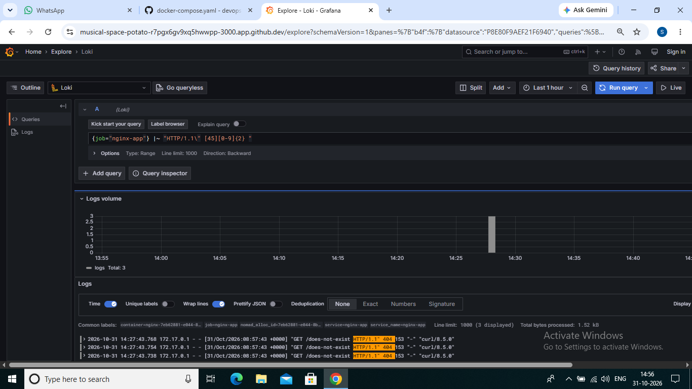

# DevOps Intern Final Assessment

- *Name:* Md. Sharjil Zaidi
- **Submission date:** 01-11-2026
- *Repository:* https://github.com/Sharjilzaidi29/devops-intern-final
- *Release tag:* v1.0.0

A small static NGINX site taken from source control through CI, an image registry and a Nomad deployment, with its logs shipped into Loki and queried from Grafana. Every section below shows the commands I ran and the output I observed.

## Architecture

text
 developer
    |  git push / pull request
    v
 GitHub ---> GitHub Actions CI (.github/workflows/ci.yml)
             lint -> build -> test -> publish (main only)
                                        |
                                        v
                     GHCR: ghcr.io/sharjilzaidi29/devops-intern-final
                     tags: <commit SHA> and latest
                                        |
                                        v
       Nomad (docker driver) + Consul service with /healthz check
                  runs the nginx-app container on port 8080
                                        |  container logs via Docker socket
                                        v
                       Promtail ---> Loki ---> Grafana (Explore)

Repository layout:

text
README.md  .gitignore
app/         Dockerfile, index.html, nginx.conf
scripts/     sysinfo.sh, healthcheck.sh
.github/workflows/ci.yml
nomad/       nginx-app.nomad.hcl
monitoring/  docker-compose.yaml, loki-config.yaml, promtail-config.yaml, loki_setup.md
docs/screenshots/

## Prerequisites

Versions used (output of the commands below):

bash
docker --version; nomad version; consul version; shellcheck --version

text
Docker version 29.8.0-1, build 88096ef00576baf72a9cb45caa45c0544c40e0a7
Nomad v2.0.7
BuildDate 2026-09-17T17:24:03Z
Revision 9dcbdc5e64ecc4ec63e42b225af729c87c87cf83
Consul v2.1.0
Revision 881572b4
Build Date 2026-10-21T07:34:22Z
Protocol 2 spoken by default, understands 2 to 3 (agent will automatically use protocol >2 when speaking to compatible agents)

ShellCheck - shell script analysis tool
version: 0.9.0

Other pinned versions: base image nginx:1.27-alpine-slim, Hadolint v2.12.0 (in CI), Loki 3.4.2, Promtail 3.4.2, Grafana 11.5.2. Docker is enough for the Quick Start. Nomad, Consul and ShellCheck are needed for the later sections.

## Quick Start

From a fresh clone to a running application (7 commands):

bash
git clone https://github.com/Sharjilzaidi29/devops-intern-final.git
cd devops-intern-final
docker build --build-arg BUILD_SHA=$(git rev-parse --short HEAD) -t devops-intern-final:local app/
docker run -d --name nginx-test -p 8080:8080 devops-intern-final:local
sleep 3 && ./scripts/healthcheck.sh
curl -i http://localhost:8080/
docker rm -f nginx-test

## Task 1: Source control

- Work was done on short-lived branches (feature/repo-setup, feature/docker-app, feature/ci-pipeline, fix/readme-badge, feature/nomad-job, feature/loki-monitoring, docs/loki-setup, docs/readme).
- Each branch was merged to main through a pull request that I reviewed myself with a short description.
- Commit messages follow feat:, fix:, docs:, ci: and chore:. A .gitignore keeps IDE files such as .idea/ out of the repository.
- The final state is tagged v1.0.0:

bash
git tag -a v1.0.0 -m "DevOps intern final assessment"
git push origin v1.0.0

Commit history (git log --oneline | head -25):

text
88cf39b Merge pull request #7 from Sharjilzaidi29/docs/loki-setup
7a42c07 docs: add loki setup notes
cae5cbc docs: add grafana explore screenshot for non-200 query
b07cccc Merge pull request #6 from Sharjilzaidi29/feature/loki-monitoring
ad05483 fix: use host networking so promtail can reach loki
bf03905 feat: add monitoring compose stack for loki, promtail and grafana
34d6242 feat: add promtail config with nomad container labels
ba465ea feat: add loki config
f6b2408 Merge pull request #5 from Sharjilzaidi29/feature/nomad-job
9a7d226 feat: add nomad job for nginx app
bcbdb64 Merge pull request #4 from Sharjilzaidi29/fix/readme-badge
f077d2a fix: remove stray terminal characters from README badge line
c37532d Merge pull request #3 from Sharjilzaidi29/feature/ci-pipeline
bb8a9a6 docs: add CI status badge
9bd7edc ci: add GitHub Actions pipeline
9234ade Merge pull request #2 from Sharjilzaidi29/feature/docker-app
2cdf143 fix: use alpine-slim base to keep image under 60MB
305b7f5 feat: add Dockerfile with non-root nginx
597a17d fix: update nginx closing brackets
ff8bdce feat: add static page and nginx config
6ca9c87 Merge pull request #1 from Sharjilzaidi29/feature/repo-setup
93cea10 feat: add sysinfo and healthcheck scripts
02bdac6 chore: add gitignore
b7a989b Initial commit

## Task 2: Linux scripting

scripts/sysinfo.sh reports user and effective UID, hostname and kernel, an ISO-8601 UTC date, disk and memory usage and the Docker daemon status. scripts/healthcheck.sh takes a URL as $1 (default http://localhost:8080), expects HTTP 200, and exits 0 on success or 1 with a diagnostic. Both start with a shebang and set -euo pipefail, and both are executable in Git (git update-index --chmod=+x).

./scripts/sysinfo.sh:

text
User: codespace
Effective UID: 1000
Hostname: codespaces-375936
Kernel: 6.8.0-1064-azure
Date: 2026-10-31T13:54:07Z
Disk usage:
Filesystem      Size  Used Avail Use% Mounted on
overlay          32G   15G   16G  48% /
Memory usage:
               total        used        free      shared  buff/cache   available
Mem:           7.8Gi       1.9Gi       273Mi        63Mi       6.0Gi       5.9Gi
Swap:             0B          0B          0B
Docker daemon: running

shellcheck scripts/*.sh:

text
shellcheck: no findings

./scripts/healthcheck.sh before the app was running (fails with exit code 1):

text
FAIL: http://localhost:8080 returned HTTP 000 (expected 200)
exit code: 1

./scripts/healthcheck.sh after the app was running:

text
OK: http://localhost:8080 returned HTTP 200
exit code: 0

## Task 3: Containerisation

app/Dockerfile uses a pinned nginx:1.27-alpine-slim base, copies a custom nginx.conf that listens on port 8080 and serves /healthz, runs as the non-root nginx user, declares EXPOSE 8080 and a HEALTHCHECK, and accepts a BUILD_SHA build argument that is written into the served page.

Build and run:

bash
docker build --build-arg BUILD_SHA=$(git rev-parse --short HEAD) -t devops-intern-final:local app/
docker run -d --name nginx-test -p 8080:8080 devops-intern-final:local

Build output (last lines):

text
#10 exporting attestation manifest sha256:614b974dbdde6e16335b0d62d81181c899890d645f0ff5daace38c1e83d11129 0.0s done
#10 exporting manifest list sha256:0491656c7ba2d3e9024f49cfdc286bf84632ee8a3e7a074565ecdfc3afa10906 0.0s done
#10 naming to docker.io/library/devops-intern-final:local done
#10 unpacking to docker.io/library/devops-intern-final:local 0.1s done
#10 DONE 0.3s

Image size (docker images devops-intern-final:local, limit is 60 MB):

text
IMAGE                       ID             DISK USAGE   CONTENT SIZE   EXTRA
devops-intern-final:local   0491656c7ba2       19.4MB         5.45MB   U    

curl -i http://localhost:8080/:

text
  % Total    % Received % Xferd  Average Speed   Time    Time     Time  Current
                                 Dload  Upload   Total   Spent    Left  Speed

  0     0    0     0    0     0      0      0 --:--:-- --:--:-- --:--:--     0
100   269  100   269    0     0   166k      0 --:--:-- --:--:-- --:--:--  262k
HTTP/1.1 200 OK
Server: nginx/1.27.5
Date: Sat, 31 Oct 2026 13:58:17 GMT
Content-Type: text/html
Content-Length: 269
Last-Modified: Sat, 31 Oct 2026 13:57:42 GMT
Connection: keep-alive
ETag: "6ae5f3d6-10d"
Accept-Ranges: bytes

<!DOCTYPE html>
<html lang="en">
<head>
  <meta charset="utf-8">
  <title>DevOps Intern Final</title>
</head>
<body>
  <h1>DevOps Intern Final Assessment</h1>
  
Name: Md. Sharjil Zaidi

  
Assessment date: 25-10-2026

  
Build: 88cf39b

</body>
</html>

curl -i http://localhost:8080/healthz:

text
  % Total    % Received % Xferd  Average Speed   Time    Time     Time  Current
                                 Dload  Upload   Total   Spent    Left  Speed

  0     0    0     0    0     0      0      0 --:--:-- --:--:-- --:--:--     0
100     3  100     3    0     0   3205      0 --:--:-- --:--:-- --:--:--  3000
HTTP/1.1 200 OK
Server: nginx/1.27.5
Date: Sat, 31 Oct 2026 13:58:33 GMT
Content-Type: text/plain
Content-Length: 3
Connection: keep-alive

ok

The container runs as a non-root user (docker exec nginx-test id):

text
uid=101(nginx) gid=101(nginx) groups=101(nginx)

Container status with the health check passing (docker ps):

text
CONTAINER ID   IMAGE                       COMMAND                  CREATED         STATUS                   PORTS                                                 NAMES
2d187f893dc7   devops-intern-final:local   "/docker-entrypoint.…"   2 minutes ago   Up 2 minutes (healthy)   80/tcp, 0.0.0.0:8080->8080/tcp, [::]:8080->8080/tcp   nginx-test

## Task 4: Continuous integration

.github/workflows/ci.yml runs on push and pull request to main:

- lint: ShellCheck on scripts/ and Hadolint (v2.12.0) on app/Dockerfile.
- build: builds the image with BUILD_SHA=${{ github.sha }} and passes it on as an artifact.
- test: loads that image, starts the container, waits until /healthz answers, then runs scripts/healthcheck.sh. The job fails if the endpoint does not return 200.
- publish: only on push to main; pushes the same image to GHCR tagged with the commit SHA and latest.

Actions are pinned to major version v4. The workflow has read-only contents permission, and only publish gets packages: write. It logs in with the built-in GITHUB_TOKEN, so no long-lived credentials are stored. The status badge is at the top of this README. The pipeline is green on main and the package is public:

bash
docker pull ghcr.io/sharjilzaidi29/devops-intern-final:latest

## Task 5: Orchestration with Nomad

nomad/nginx-app.nomad.hcl is a service job with one group and one task on the docker driver. The image tag comes from the HCL variable image_tag, whose default is a commit SHA published by CI (never latest). Another build can be deployed with nomad job run -var image_tag=<sha> nomad/nginx-app.nomad.hcl. It uses a dynamic port named http mapped to container port 8080, 100 MHz CPU and 64 MB memory (no deviation from the requested values), a Consul service with an HTTP check on /healthz (interval 10s, timeout 2s), an update stanza with max_parallel = 1, min_healthy_time = "10s", healthy_deadline = "2m", auto_revert = true, and restart and reschedule policies.

Consul and Nomad ran in dev mode:

bash
nohup consul agent -dev > /tmp/consul.log 2>&1 &
sudo nohup nomad agent -dev > /tmp/nomad.log 2>&1 &

nomad job validate nomad/nginx-app.nomad.hcl:

text
Job Warnings:
1 warning:

* group "web" defines services, but neither the group nor any of its tasks have shutdown_delay set

Job validation successful

nomad job plan nomad/nginx-app.nomad.hcl:

text
+ Job: "nginx-app"
+ Task Group: "web" (1 create)
  + Task: "nginx" (forces create)

Scheduler dry-run:
- All tasks successfully allocated.

Job Warnings:
1 warning:

* group "web" defines services, but neither the group nor any of its tasks have shutdown_delay set

Job Modify Index: 0
To submit the job with version verification run:

nomad job run -check-index 0 nomad/nginx-app.nomad.hcl

When running the job with the check-index flag, the job will only be run if the
job modify index given matches the server-side version. If the index has
changed, another user has modified the job and the plan's results are
potentially invalid.

nomad job run nomad/nginx-app.nomad.hcl:

text
Job Warnings:
1 warning:

* group "web" defines services, but neither the group nor any of its tasks have shutdown_delay set

==> View this job in the Web UI: http://127.0.0.1:4646/ui/jobs/nginx-app@default

==> 2026-10-31T14:06:33Z: Monitoring evaluation "ba19497e"
    2026-10-31T14:06:33Z: Evaluation triggered by job "nginx-app"
    2026-10-31T14:06:33Z: Evaluation within deployment: "15e8feba"
    2026-10-31T14:06:33Z: Allocation "42e821bc" created: node "f470e127", group "web"
    2026-10-31T14:06:33Z: Evaluation status changed: "pending" -> "complete"
==> 2026-10-31T14:06:33Z: Evaluation "ba19497e" finished with status "complete"
==> 2026-10-31T14:06:33Z: Monitoring deployment "15e8feba"
    
2026-10-31T14:06:33Z
ID          = 15e8feba
Job ID      = nginx-app
Job Version = 0
Status      = running
Description = Deployment is running

Deployed
Task Group  Auto Revert  Desired  Placed  Healthy  Unhealthy  Progress Deadline
web         true         1        1       0        0          2026-10-31T14:16:33Z
    
2026-10-31T14:06:53Z
ID          = 15e8feba
Job ID      = nginx-app
Job Version = 0
Status      = running
Description = Deployment is running

Deployed
Task Group  Auto Revert  Desired  Placed  Healthy  Unhealthy  Progress Deadline
web         true         1        1       1        0          2026-10-31T14:16:52Z
    
2026-10-31T14:06:54Z
ID          = 15e8feba
Job ID      = nginx-app
Job Version = 0
Status      = successful
Description = Deployment completed successfully

Deployed
Task Group  Auto Revert  Desired  Placed  Healthy  Unhealthy  Progress Deadline
web         true         1        1       1        0          2026-10-31T14:16:52Z

nomad job status nginx-app (allocation running and healthy):

text
ID            = nginx-app
Name          = nginx-app
Submit Date   = 2026-10-31T14:06:33Z
Type          = service
Priority      = 50
Datacenters   = dc1
Namespace     = default
Node Pool     = default
Status        = running
Periodic      = false
Parameterized = false

Summary
Task Group  Queued  Starting  Running  Failed  Complete  Lost  Unknown
web         0       0         1        0       0         0     0

Latest Deployment
ID          = 15e8feba
Status      = successful
Description = Deployment completed successfully

Deployed
Task Group  Auto Revert  Desired  Placed  Healthy  Unhealthy  Progress Deadline
web         true         1        1       1        0          2026-10-31T14:16:52Z

Allocations
ID        Node ID   Task Group  Version  Desired  Status   Created  Modified
42e821bc  f470e127  web         0        run      running  1m ago   40s ago

==> View job details and metrics in the Web UI: http://127.0.0.1:4646/ui/jobs/nginx-app@default

Consul health check (curl -s http://localhost:8500/v1/health/checks/nginx-app):

text
[
    {
        "Node": "codespaces-375936",
        "CheckID": "_nomad-check-494e936c31b68e84a4aedd7c7ac6774e8ac9fbcdae88235b1f5440008f32fb48",
        "Name": "service: \"nginx-app\" check",
        "Status": "passing",
        "Notes": "",
        "Output": "HTTP GET http://127.0.0.1:20916/healthz: 200 OK Output: ok\n",
        "ServiceID": "_nomad-task-42e821bc-f59b-ea92-8060-773fdbb3d574-group-web-nginx-app-http",
        "ServiceName": "nginx-app",
        "ServiceTags": [],
        "Type": "http",
        "Interval": "10s",
        "Timeout": "2s",
        "ExposedPort": 0,
        "Definition": {},
        "CreateIndex": 37,
        "ModifyIndex": 39
    }
]

## Task 6: Log aggregation with Grafana Loki

The stack in monitoring/ (Loki, Promtail, Grafana) is started with docker compose. Promtail discovers the Nomad-managed NGINX container through the Docker socket and labels its logs with job, container, nomad_alloc_id and service. Details, label table and the problems I hit are in [monitoring/loki_setup.md](monitoring/loki_setup.md).

bash
docker compose -f monitoring/docker-compose.yaml up -d

text
 Container monitoring-loki-1 Creating 
 Container monitoring-loki-1 Created 
 Container monitoring-promtail-1 Creating 
 Container monitoring-grafana-1 Creating 
 Container monitoring-promtail-1 Created 
 Container monitoring-grafana-1 Created 
 Container monitoring-loki-1 Starting 
 Container monitoring-loki-1 Started 
 Container monitoring-promtail-1 Starting 
 Container monitoring-grafana-1 Starting 
 Container monitoring-promtail-1 Started 
 Container monitoring-grafana-1 Started 

docker compose -f monitoring/docker-compose.yaml ps:

text
NAME                    IMAGE                    COMMAND                  SERVICE    CREATED          STATUS          PORTS
monitoring-grafana-1    grafana/grafana:11.5.2   "/run.sh"                grafana    46 seconds ago   Up 45 seconds   
monitoring-loki-1       grafana/loki:3.4.2       "/usr/bin/loki -conf…"   loki       46 seconds ago   Up 45 seconds   
monitoring-promtail-1   grafana/promtail:3.4.2   "/usr/bin/promtail -…"   promtail   46 seconds ago   Up 45 seconds   

curl -s http://localhost:3100/ready:

text
ready

I sent requests to the Nomad-managed container, including a deliberately missing path. Status codes of the three missing-path requests:

text
404
404
404

LogQL query that isolates the non-200 NGINX access lines:

text
{job="nginx-app"} |~ "HTTP/1.1\" [45][0-9]{2} "

Result, queried from Loki's API (labels and matching lines):

text
{'container': 'nginx-42e821bc-f59b-ea92-8060-773fdbb3d574', 'detected_level': 'unknown', 'job': 'nginx-app', 'nomad_alloc_id': '42e821bc-f59b-ea92-8060-773fdbb3d574', 'service': 'nginx-app', 'service_name': 'nginx-app'}
172.17.0.1 - - [31/Oct/2026:14:11:57 +0000] "GET /does-not-exist HTTP/1.1" 404 153 "-" "curl/8.5.0"
172.17.0.1 - - [31/Oct/2026:14:11:57 +0000] "GET /does-not-exist HTTP/1.1" 404 153 "-" "curl/8.5.0"
172.17.0.1 - - [31/Oct/2026:14:11:57 +0000] "GET /does-not-exist HTTP/1.1" 404 153 "-" "curl/8.5.0"

The same query in Grafana Explore:

## Troubleshooting

These are failures I actually ran into:

1. *Push failed with src refspec ... does not match any.* I had created the branch as feature/reop-setup (typo). Fix: git branch -m feature/repo-setup, then push again.
2. *First image was 73.6 MB, over the 60 MB limit.* The nginx:1.27-alpine base was too big. Fix: switched to nginx:1.27-alpine-slim, which gave about 19 MB (see Task 3).
3. *Stray terminal control characters ended up in the README next to the badge.* I rewrote the file with printf and checked it with cat -A.
4. *A curl ... | grep for the Consul check printed nothing.* My grep pattern was wrong. Printing the full JSON showed the check as passing.
5. *Loki stayed empty and Promtail logged error sending batch ... context deadline exceeded.* Loki itself was healthy (/ready, a manual push returned 204), but a test container on the compose network timed out reaching http://loki:3100. Fix: network_mode: host for the three services and the Promtail client URL http://localhost:3100. I did not find the root cause of the compose network timeout in Codespaces.
6. */ready answered Ingester not ready: waiting for 15s after being ready.* That is Loki's normal start delay; it said ready about 20 seconds later.
7. *docker compose up -d failed with RWLayer of container ... is unexpectedly nil after a Codespace restart.* Old monitoring containers were left broken. Fix: docker rm -f on them, pull the images again and run up -d.
8. *The first non-200 query in Grafana failed with parse error ... unexpected <, expecting STRING.* The pattern template was not wrapped in backticks. Fix: used a plain regex line filter.

## Known Limitations

- Nomad and Consul run in dev mode on one machine. Jobs and registrations are lost on restart, there is no ACL and no TLS.
- Grafana allows anonymous admin access and the monitoring services use host networking. This is fine for a demo, not for production.
- Loki uses local filesystem storage and has no retention policy.
- The scripts use #!/usr/bin/env bash because set -o pipefail is not available in every POSIX sh. The commands inside are plain, but free -h is Linux specific.
- The Nomad job's default image tag is a hard-coded commit SHA. A real setup would pass the SHA from CI.
- The NGINX page is a minimal static page I wrote for this assessment, not a fork of an existing project.
- Everything was run and verified in GitHub Codespaces only. With more time I would add an automated deployment step, a Grafana dashboard committed as JSON and Nomad ACLs.